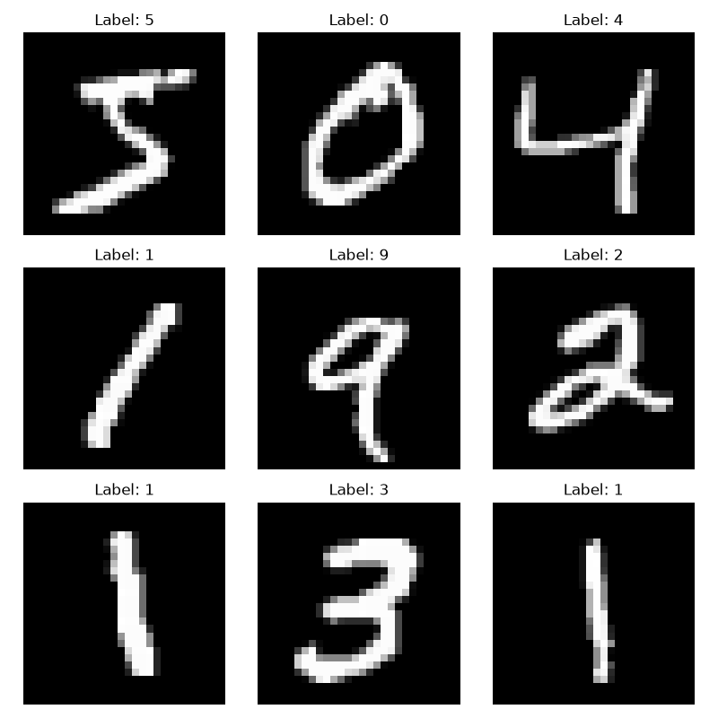

# MNIST Forward Pass in CUDA

A small neural network (784 → 128 → 10) that classifies handwritten digits.
Python/Keras trains the model and exports the weights and biases. CUDA then runs the forward pass on the GPU.

```
Input (784) → MatMul W1 → + b1 → ReLU → MatMul W2 → + b2 → Softmax → Prediction (0–9)
```

New to forward passes? Read [ForwardPass_Notes.pdf](ForwardPass_Notes.pdf) first for a short overview.

## What the data looks like



These pictures are only a high-level view. The network never sees image files.
Each digit is a 28 × 28 grid of numbers, flattened into one array of 784 values:

- `0` = black (background)
- `255` = white (the pen stroke)
- Values in between are the gray pixels along the edges of each stroke

`x_test.bin` stores the raw 0–255 values. The CUDA program divides each one by 255 so it falls between `0.0` and `1.0`, the same scaling Keras used during training.
`x_test.bin` holds 10,000 of these arrays, one after another.

## Tested on

- **GPU:** NVIDIA Quadro K2200 (Maxwell, `sm_50`)
- **OS:** Ubuntu 26.04 LTS

It should also run on Windows, but it hasn't been tested there yet. See the Windows notes in Steps 3 and 4.

## Requirements

- An NVIDIA GPU with the CUDA Toolkit (`nvcc`) installed
- Python 3 with `numpy`, `tensorflow` and `matplotlib`
- `make`

## Step 1: Create the weights and biases

This repo contains no data or weight files, only code. You generate them yourself on your own machine with the script below.

```bash
cd datasets
python -m venv .venv
source .venv/bin/activate          # Windows: .venv\Scripts\activate
pip install numpy tensorflow matplotlib
python TrainMnist_mlp.py
```

The script:
1. Downloads MNIST (it is cached at `~/.keras/datasets/mnist.npz`)
2. Trains the model for 5 epochs and prints the Keras test accuracy
3. Writes these raw `float32`/`int32` files to the folder you ran it from:

| File         | Shape        | Contents                 |
|--------------|--------------|--------------------------|
| `W1.bin`     | 784 × 128    | Layer 1 weights          |
| `b1.bin`     | 128          | Layer 1 biases           |
| `W2.bin`     | 128 × 10     | Layer 2 weights          |
| `b2.bin`     | 10           | Layer 2 biases           |
| `x_test.bin` | 10000 × 784  | Test images (raw 0–255)  |
| `y_test.bin` | 10000        | Test labels (`int32`)    |

It also opens a window that shows 9 sample digits. Close the window to finish.

## Step 2: Move the files into `BinaryFiles/`

The CUDA program reads its input from `./BinaryFiles/`, so move the six `.bin` files there:

```bash
mkdir -p ../BinaryFiles
mv *.bin ../BinaryFiles/
cd ..
```

## Step 3: Build

```bash
make
```

This compiles every `.cu` file into one executable called `Output`.
`-arch=sm_50` in the `Makefile` matches the K2200. If you have a different GPU, or `nvcc` rejects `sm_50`, change `FLAG` to match your card (for example `-arch=sm_86`).

**Windows:** if you don't have `make`, compile directly:

```bash
nvcc -arch=sm_50 ActivationFunc.cu MatrixMul.cu Bias.cu NeuralNetForwPass.cu -o Output
```

## Step 4: Run

Run it from the project root so the `./BinaryFiles/` paths resolve:

```bash
./Output          # Windows: Output.exe
```

The output looks like this:

```
Image 0: 0.0001 0.0000 ... 0.9990 ...     ← softmax probabilities for the first 5 images
...
Loaded 10000 labels
Accuracy: XXXX / 10000
```

To delete the executable, run `make clean`.

## What each file does

| File                   | Role                                                       |
|------------------------|------------------------------------------------------------|
| `NeuralNetForwPass.cu` | `main()`: loads files, launches kernels, checks accuracy |
| `MatrixMul.cu`         | `vMatrixMultiplication`: multiplies two matrices         |
| `Bias.cu`              | `vBias`: adds a bias to each row                         |
| `ActivationFunc.cu`    | `vReLU` and `vSoftmax` activations                       |
| `Includes.h`, `BaseTypes.h` | Kernel declarations and the `F4`/`I4` types         |
